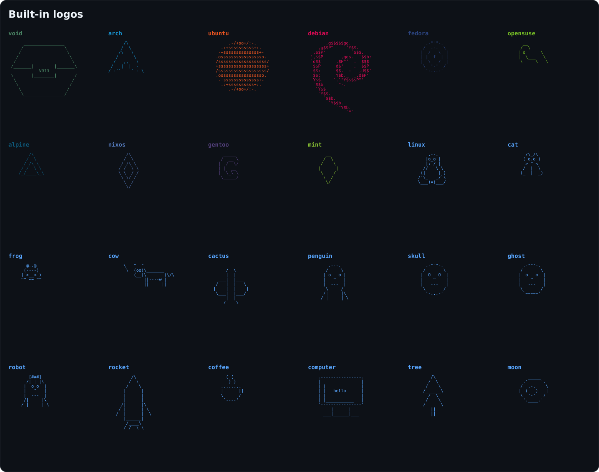

<div align="center">


**A tiny system fetch for Linux — pure Python, zero dependencies.**

[](https://github.com/pybindi/nullfetch/releases)
[](https://www.python.org/)
[](#)
[](#)
[](LICENSE)
[](https://github.com/pybindi/nullfetch/actions/workflows/check.yml)


</div>

## ✨ Features

- 👤 user and hostname
- 🐧 distribution and kernel
- 🖥️ CPU and GPU
- 🧠 RAM and disk usage with bars and percentages
- 🎨 distro logo, colored with your distro's color (truecolor, 256-color fallback)
- 🧩 text next to the logo, like a real fetch
- 🖼 `--logo NAME` to pick any logo from `logos.py`
- 📐 adapts to narrow terminals instead of wrapping
- 🔤 `--ascii` for terminals without block characters
- 📏 `--width N` and `--oneline` for scripts and status bars
- 🎛 `--accent COLOR` and `--logo-file FILE`
- 🙈 `--no-logo` for a text-only output
- 🎯 `--only` to pick fields
- 🤖 `--json` for scripts
- 📦 standard library only — nothing to install

## 📥 Installation

### Any Linux

```bash
git clone https://github.com/pybindi/nullfetch.git
cd nullfetch
./install.sh
```

`install.sh` puts the script into `~/.local/bin`. To use another prefix:

```bash
PREFIX=/usr/local sudo ./install.sh
```

Manual install, if you prefer:

```bash
chmod +x nullfetch.py
ln -s "$PWD/nullfetch.py" ~/.local/bin/nullfetch
```

### Arch Linux

A `PKGBUILD` is included:

```bash
git clone https://github.com/pybindi/nullfetch.git
cd nullfetch
makepkg -si
```

`pacman` pulls `python` automatically. `pciutils` is optional and only needed
for GPU detection.

### Debian / Ubuntu

A prebuilt `.deb` is attached to every release:

```bash
sudo apt install ./nullfetch_1.5.0_all.deb
```

Or build it from source:

```bash
sudo apt install dpkg-dev
./scripts/build-deb.sh
sudo apt install ./dist/nullfetch_1.5.0_all.deb
```

## 🚀 Usage

```bash
nullfetch                    # logo + system info
nullfetch --only cpu,ram     # just two lines
nullfetch --no-logo          # text only
nullfetch --json             # machine-readable output
nullfetch --oneline          # one line for a status bar
nullfetch --ascii            # no block characters
nullfetch --accent '#ff0000' # red logo
```

### Options

| Option | Description |
| :--- | :--- |
| `-h`, `--help` | Show help and exit |
| `--version` | Show version and exit |
| `--no-logo` | Hide the ASCII logo |
| `--logo NAME` | Logo to show: `auto`, `none`, or a name from `logos.py` |
| `--logo-file FILE` | Use a custom ASCII art file |
| `--accent COLOR` | Accent color in `#rrggbb` |
| `--no-color` | Disable colors (also honors `NO_COLOR`) |
| `--ascii` | ASCII-only bars, ellipsis and separators |
| `--width N` | Output width in columns |
| `--oneline` | One compact line for status bars |
| `-o`, `--only FIELDS` | Show only the listed fields |
| `--json` | Print system info as JSON |

### Fields

```text
user host os kernel cpu gpu ram disk
```

### Logos

`--logo auto` picks the logo of your distribution. Other values:

```bash
nullfetch --logo arch
nullfetch --logo cat
nullfetch --logo none
```

Available names: `alpine`, `arch`, `cactus`, `cat`, `coffee`, `computer`,
`cow`, `debian`, `fedora`, `frog`, `gentoo`, `ghost`, `linux`, `mint`, `moon`,
`nixos`, `opensuse`, `penguin`, `robot`, `rocket`, `skull`, `tree`, `ubuntu`,
`void`.



### Shell completion

```bash
# bash
source scripts/completions/nullfetch.bash

# zsh
source scripts/completions/_nullfetch

# fish
source scripts/completions/nullfetch.fish
```

## ⚡ Speed

Small on purpose:

| | |
| :--- | :--- |
| startup | ~68 ms |
| output | 8 lines |
| dependencies | 0 |

Measured on an Intel i7-4600U running Void Linux:

```bash
time nullfetch >/dev/null
```

## 🖼 Example output

```text
      ________________         USER: matuha
     /                \        HOST: void
    /                  \       OS: Void Linux
   /                    \      kernel: 6.18.60_1
  /       ________       \     CPU: Intel(R) Core(TM) i7-4600U CPU @ 2.10GHz
 /_______|        |_______\    GPU: Intel Corporation Haswell-ULT Integrated Graphics Controller
 _________  V0ID   ________    RAM: 2 / 7 GB      ███░░░░░░░░░  29%
 \       |________|       /    disk: 31 / 237 GB   ██░░░░░░░░░░  13%
  \                      /
   \                    /
    \                  /
     \________________/
```

## 🤖 JSON output

```bash
nullfetch --json
```

```json
{
  "user": "matuha",
  "host": "void",
  "os": "Void Linux",
  "kernel": "6.18.60_1",
  "cpu": "Intel(R) Core(TM) i7-4600U CPU @ 2.10GHz",
  "gpu": "Intel Corporation Haswell-ULT Integrated Graphics Controller",
  "ram": { "used": 3, "total": 7, "percent": 43 },
  "disk": { "used": 31, "total": 237, "percent": 13 }
}
```

## 🎨 Custom logo

[`logos.py`](logos.py) collects a set of ASCII art. Pick one and paste it into
the `ART` string in `nullfetch.py`:

```python
ART = r"""        .--.
       |o_o |
       |:_/ |
      //   \ \
     (|     | )
    /'\_   _/`\
    \___)=(___/"""
```

> `r"""..."""` is a raw multi-line string, so backslashes in the art do not
> need to be escaped.

The logo is colored with the color of your distribution. Add new colors in
`DISTRO_COLORS`.

## 🗂 Project structure

```text
nullfetch/
├── nullfetch.py        # the fetch itself
├── pyproject.toml      # packaging metadata and ruff config
├── logos.py            # ASCII art collection
├── nullfetch.1         # man page
├── install.sh          # installer for ~/.local
├── assets/
│   ├── banner.png      # README header
│   ├── demo.gif        # animated preview
│   ├── demo.svg        # static preview
│   └── logos.png       # gallery of built-in logos
├── scripts/
│   ├── build-deb.sh    # builds dist/*.deb
│   └── completions/    # bash, zsh and fish completion
├── tests/
│   └── test_cli.py     # pytest suite
├── debian/             # Debian packaging metadata
├── PKGBUILD            # Arch Linux package
├── .github/workflows/  # tests + .deb on release
├── CONTRIBUTING.md
├── LICENSE
└── README.md
```

## 🧩 Requirements

- Python **3.10+**
- Linux (`platform.freedesktop_os_release`)
- optional: `pciutils` for GPU detection

## 🤝 Contributing

See [CONTRIBUTING.md](CONTRIBUTING.md). Tests are run with:

```bash
python -m pytest -q
```

## 📄 License

[MIT](LICENSE) — free to use, modify and share.
