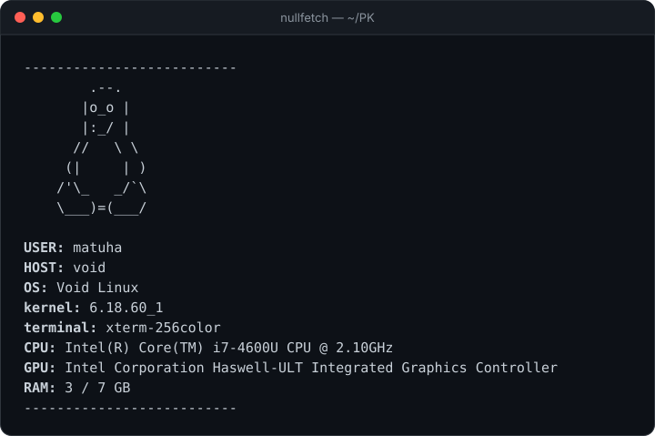

<div align="center">

# nullfetch

**Минималистичный fetch для терминала — на чистом Python, без зависимостей.**

[](https://www.python.org/)
[](#)
[](#)
[](LICENSE)
[](https://github.com/pybindi/nullfetch/actions/workflows/check.yml)



</div>

## ✨ Возможности

- 👤 имя пользователя и имя компьютера;
- 🐧 дистрибутив Linux и версия ядра;
- 💻 архитектура процессора;
- 🎨 ASCII-логотип и жирные подписи;
- 📦 только стандартная библиотека Python — ничего устанавливать не нужно;
- 🚀 запускается как обычная команда.

## 📦 Установка

```bash
git clone https://github.com/pybindi/nullfetch.git
cd nullfetch

chmod +x nullfetch.py
ln -s "$PWD/nullfetch.py" ~/.local/bin/nullfetch
```

Убедись, что `~/.local/bin` есть в `PATH`:

```bash
echo "$PATH" | grep -q "$HOME/.local/bin" && echo OK
```

## 🚀 Использование

Из папки проекта:

```bash
python nullfetch.py
```

Или как команду, из любого места:

```bash
nullfetch
```

Пример вывода:

```text
        .--.
       |o_o |
       |:_/ |
      //   \ \
     (|     | )
    /'\_   _/`\
    \___)=(___/
USER: matuha
HOST: void
OS: Void Linux
kernel: 6.18.60_1
architecture: x86_64
```

## 🖼 Свои рисунки

В файле [`logos.py`](logos.py) собрана коллекция ASCII-рисунков. Можно взять
любой и вставить в `printlogo()`:

```python
def printlogo():
    print(r"""        .--.
       |o_o |
       |:_/ |
      //   \ \
     (|     | )
    /'\_   _/`\
    \___)=(___/""")
```

> `r"""..."""` — «сырая» многострочная строка: обратные слэши в рисунке
> не нужно удваивать.

## 🗂 Структура проекта

```text
nullfetch/
├── nullfetch.py        # сам fetch
├── logos.py            # коллекция ASCII-рисунков
├── assets/
│   └── demo.svg        # картинка для README
├── .github/workflows/  # проверка синтаксиса при push
├── LICENSE
└── README.md
```

## 🧩 Требования

- Python **3.10+**;
- Linux (используется `platform.freedesktop_os_release`).

## 📄 Лицензия

[MIT](LICENSE) — используй, меняй и распространяй свободно.
