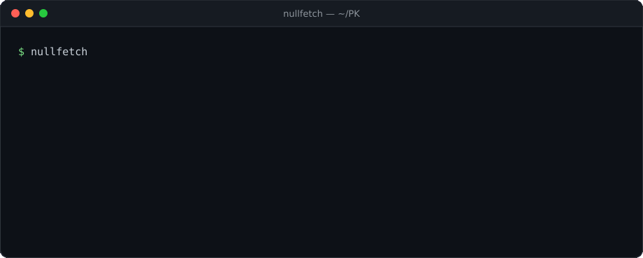

<div align="center">


**A tiny system fetch for Linux — pure Python, zero dependencies.**

[](https://github.com/pybindi/nullfetch/releases)
[](https://www.python.org/)
[](#)
[](#)
[](LICENSE)
[](https://github.com/pybindi/nullfetch/actions/workflows/check.yml)



</div>

## ✨ Features

- 👤 user and hostname
- 🐧 distribution, kernel, uptime
- ⌨️ shell, desktop environment, terminal
- 🖥️ CPU and GPU
- 🧠 RAM and disk usage
- 📦 installed package count
- 🎨 logo colored with your distro's color (truecolor, 256-color fallback)
- 🧩 text next to the logo, like a real fetch
- 🙈 `--no-logo` for a text-only output
- 🎯 `--only` to pick fields
- 🤖 `--json` for scripts
- 📦 standard library only — nothing to install

## 📥 Installation

### Any Linux

```bash
git clone https://github.com/pybindi/nullfetch.git
cd nullfetch
./install.sh
```

`install.sh` puts the script into `~/.local/bin`. To use another prefix:

```bash
PREFIX=/usr/local sudo ./install.sh
```

Manual install, if you prefer:

```bash
chmod +x nullfetch.py
ln -s "$PWD/nullfetch.py" ~/.local/bin/nullfetch
```

### Arch Linux

A `PKGBUILD` is included:

```bash
git clone https://github.com/pybindi/nullfetch.git
cd nullfetch
makepkg -si
```

`pacman` pulls `python` automatically. `pciutils` is optional and only needed
for GPU detection.

### Debian / Ubuntu

A prebuilt `.deb` is attached to every release:

```bash
sudo apt install ./nullfetch_1.2.0_all.deb
```

Or build it from source:

```bash
sudo apt install dpkg-dev
./scripts/build-deb.sh
sudo apt install ./dist/nullfetch_1.2.0_all.deb
```

## 🚀 Usage

```bash
nullfetch                 # logo + system info
nullfetch --only cpu,ram  # just two lines
nullfetch --no-logo       # text only
nullfetch --json          # machine-readable output
```

### Options

| Option | Description |
| :--- | :--- |
| `-h`, `--help` | Show help and exit |
| `--version` | Show version and exit |
| `--no-logo` | Hide the ASCII logo |
| `--no-color` | Disable colors (also honors `NO_COLOR`) |
| `-o`, `--only FIELDS` | Show only the listed fields |
| `--json` | Print system info as JSON |

### Fields

```text
user host os kernel uptime shell terminal de cpu gpu ram disk packages
```

## 🖼 Example output

```text
        .--.       USER: matuha
       |o_o |      HOST: void
       |:_/ |      OS: Void Linux
      //   \ \     kernel: 6.18.60_1
     (|     | )    uptime: 2d 3h 14m
    /'\_   _/`\    shell: bash
    \___)=(___/    terminal: xterm-256color
                   DE: sway
                   CPU: Intel(R) Core(TM) i7-4600U CPU @ 2.10GHz
                   GPU: Intel Corporation Haswell-ULT Integrated Graphics Controller
                   RAM: 3 / 7 GB
                   disk: 31 / 237 GB
                   packages: 779
```

## 🤖 JSON output

```bash
nullfetch --json
```

```json
{
  "user": "matuha",
  "host": "void",
  "os": "Void Linux",
  "kernel": "6.18.60_1",
  "uptime": "2d 3h 14m",
  "shell": "bash",
  "terminal": "xterm-256color",
  "de": "sway",
  "cpu": "Intel(R) Core(TM) i7-4600U CPU @ 2.10GHz",
  "gpu": "Intel Corporation Haswell-ULT Integrated Graphics Controller",
  "ram": "3 / 7 GB",
  "disk": "31 / 237 GB",
  "packages": "779"
}
```

## 🎨 Custom logo

[`logos.py`](logos.py) collects a set of ASCII art. Pick one and paste it into
the `ART` string in `nullfetch.py`:

```python
ART = r"""        .--.
       |o_o |
       |:_/ |
      //   \ \
     (|     | )
    /'\_   _/`\
    \___)=(___/"""
```

> `r"""..."""` is a raw multi-line string, so backslashes in the art do not
> need to be escaped.

The logo is colored with the color of your distribution. Add new colors in
`DISTRO_COLORS`.

## 🗂 Project structure

```text
nullfetch/
├── nullfetch.py        # the fetch itself
├── logos.py            # ASCII art collection
├── nullfetch.1         # man page
├── install.sh          # installer for ~/.local
├── assets/
│   ├── banner.png      # README header
│   ├── demo.gif        # animated preview
│   └── demo.svg        # static preview
├── scripts/
│   └── build-deb.sh    # builds dist/*.deb
├── tests/
│   └── test_cli.py     # pytest suite
├── debian/             # Debian packaging metadata
├── PKGBUILD            # Arch Linux package
├── .github/workflows/  # tests + .deb on release
├── CONTRIBUTING.md
├── LICENSE
└── README.md
```

## 🧩 Requirements

- Python **3.10+**
- Linux (`platform.freedesktop_os_release`)
- optional: `pciutils` for GPU detection

## 🤝 Contributing

See [CONTRIBUTING.md](CONTRIBUTING.md). Tests are run with:

```bash
python -m pytest -q
```

## 📄 License

[MIT](LICENSE) — free to use, modify and share.
