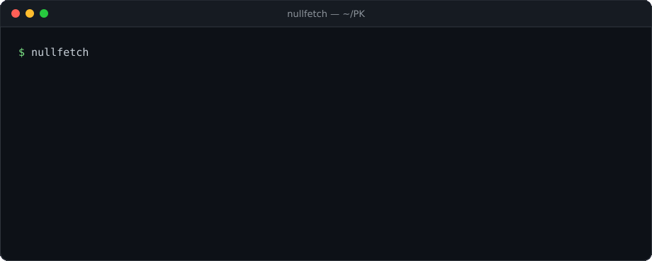
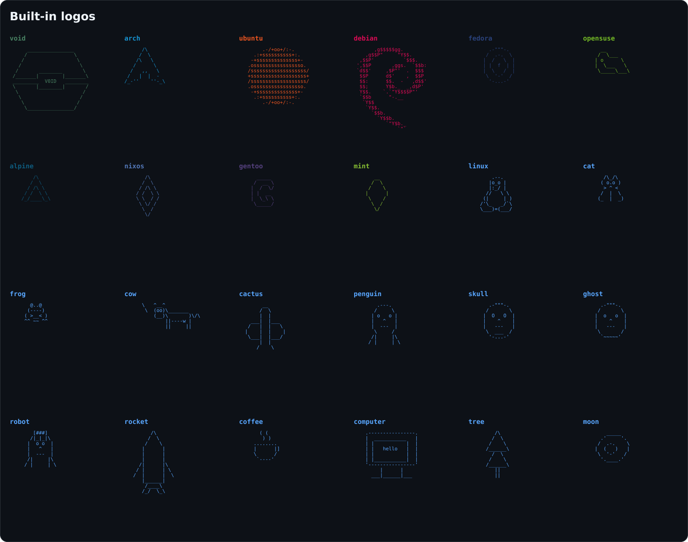

<div align="center">


# nullfetch

**A fast, tiny, no-nonsense system fetch for Linux.**  
Pure Python. Zero required dependencies. Terminal images. 31 modules. Presets. Command modules. Your config.

<p>
  <a href="https://github.com/pybindi/nullfetch/releases"></a>
  <a href="https://www.python.org/"></a>
  <a href="#"></a>
  <a href="#"></a>
  <a href="LICENSE"></a>
</p>

<p>
  <a href="#-quick-start">Quick Start</a> •
  <a href="#-features">Features</a> •
  <a href="#-images">Images</a> •
  <a href="#-modules">Modules</a> •
  <a href="#-configuration">Configuration</a> •
  <a href="#-options">Options</a>
</p>



</div>

---

## Why nullfetch

| | |
|---|---|
| **Fast by default** | Modules are collected in parallel, slow values are cached, and `/etc/os-release` lookups are memoized. |
| **Looks good everywhere** | ASCII logos, distro colors, themes, custom separators, bar styles, compact layout, and plain `--ascii` mode. |
| **More than logos** | Built-in PNG rendering, Kitty/iTerm2 protocols, and optional external converters for other formats. |
| **Script-friendly** | `text`, `json`, `csv`, `markdown`, and `oneline` outputs with predictable module selection. |
| **Zero required deps** | Runs with Python standard library on Linux. Optional tools only unlock extra image/GPU capabilities. |

## ✨ Features

<table>
<tr>
<td width="50%" valign="top">

### System info
- 31 modules, from classic fetch fields to loadavg, boot/init, DE/WM, packages, temperature, network, locale, and more.
- `--all` for everything, `--only` for a precise set.
- Custom command modules: `command:name:cmd`.
- Parallel collection, short-TTL cache, and `--timing` with slowest modules.

</td>
<td width="50%" valign="top">

### Terminal visuals
- Distro-aware logos and custom ASCII art files.
- 11 themes, named/hex accents, `#rgb`/`#rrggbb`.
- 5 bar styles: `blocks`, `ascii`, `arrows`, `dots`, `lines`.

</td>
</tr>
<tr>
<td width="50%" valign="top">

### Images in terminal
- Built-in PNG decoder (stdlib only).
- Half-block color rendering or plain ASCII.
- Kitty and iTerm2 protocols.
- Optional `chafa`, `viu`, `jp2`, `img2txt`, `timg`, `sixel`.

</td>
<td width="50%" valign="top">

### Works in scripts
- `--json` for machines, `--format markdown/csv` for reports.
- `--oneline` for status bars.
- `--timing` to inspect collection performance.
- Stable default JSON fields for compatibility.

</td>
</tr>
</table>

## 🚀 Quick Start

### Install

```bash
git clone https://github.com/pybindi/nullfetch.git
cd nullfetch
./install.sh
```

<details>
<summary><b>More install options</b></summary>

#### Manual

```bash
chmod +x nullfetch.py
ln -s "$PWD/nullfetch.py" ~/.local/bin/nullfetch
```

Keep `nullfetch_image.py` and `logos.py` next to the script, or in `$prefix/share/nullfetch/`.

#### Arch Linux

```bash
git clone https://github.com/pybindi/nullfetch.git
cd nullfetch
makepkg -si
```

Set the release archive checksum in `PKGBUILD` / `.SRCINFO` after tagging a release.

#### Debian / Ubuntu

```bash
sudo apt install ./nullfetch_2.0.0_all.deb
```

Build from source:

```bash
sudo apt install dpkg-dev
./scripts/build-deb.sh
sudo apt install ./dist/nullfetch_2.0.0_all.deb
```

Verify release checksums:

```bash
sha256sum -c SHA256SUMS
```

</details>

### Try it

```bash
nullfetch                          # classic logo + default modules
nullfetch --all                    # every module
nullfetch --preset dev             # ready-made layout for dev machines
nullfetch --only cpu,ram,temperature
nullfetch --only user,command:git:git\ branch\ --show-current
nullfetch --doctor                 # check terminal/image/capabilities
nullfetch --theme dracula --bar-style dots
nullfetch --image ~/wallpaper.png  --image-mode blocks
```

## 🖼 Images

`nullfetch` can render images next to your system info.

```bash
nullfetch --image ~/wallpaper.png
nullfetch --image photo.jpg --image-mode chafa --image-position top
nullfetch --image avatar.png --image-mode blocks --image-width 30
nullfetch --image logo.png --image-mode ascii --color never
nullfetch --image logo.png --image-mode kitty
```

| Mode | Needs | Best for |
|:-----|:------|:---------|
| `auto` | — | Picking the best available renderer |
| `blocks` | PNG | Built-in color output, no external tools |
| `ascii` | PNG | Plain terminals / no color |
| `kitty` | Kitty + PNG | Native high-quality terminal graphics |
| `iterm` | iTerm2 / WezTerm | Inline image protocol |
| `chafa`, `sixel` | `chafa` | Many formats, good quality |
| `viu`, `jp2`, `img2txt`, `timg` | matching tool | External fallback converters |

> [!TIP]
> The built-in decoder supports **non-interlaced PNG**. For JPEG/WebP/GIF/interlaced PNG, use `chafa`, `viu`, `timg`, or the iTerm2 protocol.

## 🧩 Modules

**Default:** `user host os kernel cpu gpu ram disk`

**Extra:** `arch uptime boot_time loadavg cpu_cores swap disks network local_ip public_ip battery temperature resolution shell terminal de wm packages processes init locale timezone date`

**Custom:** `command:<name>:<cmd>` (use in `--only` or config `modules`)

```bash
nullfetch --list-fields
nullfetch --all
nullfetch --all --no-network
nullfetch --only uptime,shell,de,wm,packages
nullfetch --only os,command:git:git\ branch\ --show-current
```

> [!NOTE]
> `public_ip` is only queried when requested. Slow modules are collected in parallel and cached for a short TTL. Control with `--cache-ttl N` or `--no-cache`.

## ⚙ Configuration

Save your look once, keep it forever:

```bash
nullfetch --logo cat --accent orange --theme neon --save-config
nullfetch --preset dev --save-config
nullfetch --show-config
nullfetch --reset-config
```

Edit config directly or by key:

```bash
nullfetch --init-config
nullfetch --set theme=gruvbox
nullfetch --set modules=os,cpu,ram,temperature
nullfetch --set image=$HOME/avatar.png
```

<details>
<summary><b>Config details</b></summary>

- Path: `~/.config/nullfetch/config.json` (or `$XDG_CONFIG_HOME/nullfetch/config.json`)
- Alternate file: `--config FILE`
- CLI options override config values.
- Keys: `logo`, `logo-file`, `accent`, `theme`, `color`, `preset`, `image`, `image-mode`, `image-width`, `image-height`, `image-position`, `image-bg`, `modules`, `separator`, `bar-style`, `bar-width`, `format`, `cache-ttl`, `ascii`, `compact`, `all`, `no-cache`, `no-network`, `timing`.

**Themes:** `default mono light neon dark nord gruvbox dracula tokyo solarized matrix`  
**Colors:** named colors, distro names, `#rrggbb`, `#rgb`  
**Presets:** `minimal`, `full`, `dev`, `server`

</details>

## 📤 Output Formats

```bash
nullfetch --json
nullfetch --format markdown --only os,cpu,ram
nullfetch --format csv --only user,host,ram
nullfetch --oneline
```

```json
{
  "user": "matuha",
  "host": "void",
  "os": "Void Linux",
  "kernel": "6.18.60_1",
  "cpu": "Intel(R) Core(TM) i7-4600U CPU @ 2.10GHz",
  "gpu": "Intel Corporation Haswell-ULT Integrated Graphics Controller",
  "ram": { "used": 2.4, "total": 7.7, "percent": 31 },
  "disk": { "used": 31.2, "total": 237.4, "percent": 13 }
}
```

## 🧰 Options

<details open>
<summary><b>Common options</b></summary>

| Option | Description |
|:---|:---|
| `-h`, `--help` | Show help |
| `--version` | Show version |
| `--all` | Show every module |
| `--preset NAME` | Built-in preset: `minimal`, `full`, `dev`, `server` |
| `--doctor` | Diagnostics for terminal/image/cache |
| `-o`, `--only FIELDS` | Show selected modules / `command:name:cmd` |
| `--list-fields` | List module names |
| `--list-presets` | List presets |
| `--json` | JSON output |
| `--format FORMAT` | `text`, `json`, `csv`, `markdown`, `oneline` |
| `--oneline` | Compact one-line output |
| `--timing` | Print collection time and slowest modules |

</details>

<details>
<summary><b>Look & feel</b></summary>

| Option | Description |
|:---|:---|
| `--logo NAME` | `auto`, `none`, or logo name |
| `--logo-file FILE` | Custom ASCII art file |
| `--accent COLOR` | Name, distro name, `#rgb`, `#rrggbb` |
| `--theme NAME` | Visual theme |
| `--color MODE` | `auto`, `always`, `never` |
| `--no-color` | Disable colors |
| `--ascii` | ASCII-only bars/separators |
| `--compact` | Tighter layout |
| `--separator TEXT` | Label/value separator |
| `--bar-style STYLE` | `blocks`, `ascii`, `arrows`, `dots`, `lines` |
| `--bar-width N` | Bar width |

</details>

<details>
<summary><b>Images & config</b></summary>

| Option | Description |
|:---|:---|
| `--image FILE` | Image to display |
| `--image-mode MODE` | Renderer mode |
| `--image-width N` / `--image-height N` | Image size in cells |
| `--image-position P` | `side`, `top`, `bottom` |
| `--image-bg COLOR` | Background for transparent pixels |
| `--list-image-modes` | List image renderers |
| `--save-config` / `--show-config` | Save or inspect defaults |
| `--reset-config` / `--init-config` | Reset or create example config |
| `--set KEY=VALUE` | Change one config key |
| `--config FILE` | Alternate config file |
| `--no-cache` / `--cache-ttl N` | Cache control |
| `--no-network` | Skip network modules |

</details>

## 🎨 Logos

Pick a logo by name, or bring your own:

```bash
nullfetch --list-logos
nullfetch --logo arch
nullfetch --logo-file ~/art.txt
```

<div align="center">
  
</div>

## ⚡ Performance

```bash
time nullfetch >/dev/null
nullfetch --timing
nullfetch --doctor
nullfetch --only os,kernel,cpu,ram --no-logo
```

- Concurrent module collection
- Cached slow values under `$XDG_CACHE_HOME/nullfetch`
- Lazy imports for heavy stdlib modules
- `--no-cache` when you want fresh values

## 🗂 Project Structure

```text
nullfetch/
├── nullfetch.py        # CLI, modules, rendering
├── nullfetch_image.py  # PNG decoder + terminal image protocols
├── logos.py            # ASCII art collection
├── assets/             # banner, demo, logos
├── scripts/            # completions + packaging helpers
├── tests/              # pytest suite
├── debian/             # Debian packaging
└── PKGBUILD            # Arch packaging
```

## 🤝 Contributing

Contributions are welcome. See [CONTRIBUTING.md](CONTRIBUTING.md).

```bash
python -m pytest -q
```

## 📄 License

[MIT](LICENSE) — free to use, modify, and share.

<div align="center">
  <sub>Made for people who want their terminal to say “I use Linux” without saying a word.</sub>
</div>
